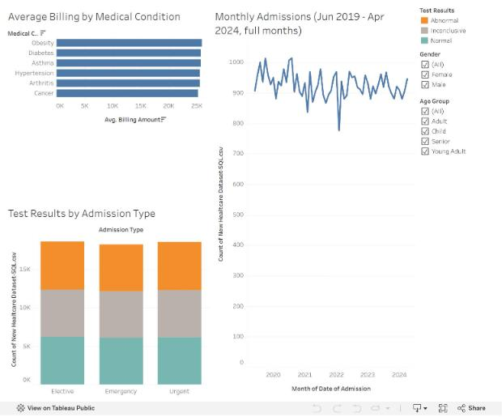

# Healthcare Patient Analytics Dashboard

Tools: SQL Server, Tableau Public
Dataset: 55,500 healthcare patient records

Interactive Tableau dashboard of patient admissions, billing, medical conditions and test results. The data is cleaned in SQL Server.

**[View the live dashboard on Tableau Public](https://public.tableau.com/views/HealthcareAdmissionsDashboard/Dashboard1)**

## Dashboard preview


## Business questions
- What is the average bill for each medical condition?
- How have monthly admissions changed over time?
- How do test results (Normal, Abnormal, Inconclusive) split across admission types (Elective, Urgent, Emergency)?
- How do these patterns change by gender and age group (Child, Young Adult, Adult, Senior)?

## KPIs
- Total patients: 55.5K
- Total billing: $1.42B
- Average billing: $25.54K
- Average length of stay: 15.5 days

## Visuals
- **Average Billing by Medical Condition:** sorted horizontal bar chart.
- **Monthly Admissions:** line chart from Jun 2019 to Apr 2024. The partial first and last months are left out so they don't show up as false drops.
- **Test Results by Admission Type:** stacked bars colored teal for Normal, gray for Inconclusive and orange for Abnormal.

## Interactivity
- Clicking a bar in the billing chart or the test-results chart filters the rest of the dashboard.
- Gender and Age Group filters apply to every chart.

## Data preparation (SQL Server)
- Imported the dataset into SQL Server.
- Set negative billing amounts to 0.
- Calculated Length of Stay as Discharge Date minus Admission Date.
- Created Age Group (Child, Young Adult, Adult, Senior).
- Exported the cleaned table to CSV and loaded it into Tableau Public.

```sql
SELECT
    Name,
    Age,
    CASE WHEN Age < 18 THEN 'Child'
    WHEN Age <= 40 THEN 'Young Adult'
    WHEN Age <= 60 THEN 'Adult'
    ELSE 'Senior'
    END AS AgeGroup,
    Gender,
    Blood_Type,
    Medical_Condition,
    Date_of_Admission,
    Discharge_Date,
    Insurance_Provider,
    Admission_Type,
    Test_Results,
    CASE WHEN Billing_Amount < 0 THEN 0 ELSE Billing_Amount END AS Billing_Amount,
    DATEDIFF(DAY, Date_of_Admission, Discharge_Date) AS Length_of_Stay
FROM healthcare.dbo.healthcare;
```

## SQL analysis scripts
| File | What it does |
|---|---|
| `cleaning Data.sql` | Cleans the data and builds the derived columns |
| `Overall KPI.sql` | Headline KPIs: patients, billing, length of stay |
| `Patients & Billing by Medical Condition.sql` | Volume and billing by condition |
| `Admission Type Summary.sql` | Elective, Urgent and Emergency comparison |
| `Billing by Insurance Provider.sql` | Billing by insurer |
| `Test Results Distribution.sql` | Test result breakdown |

## Tools
SQL · SQL Server · Tableau Public · KPI Dashboards
